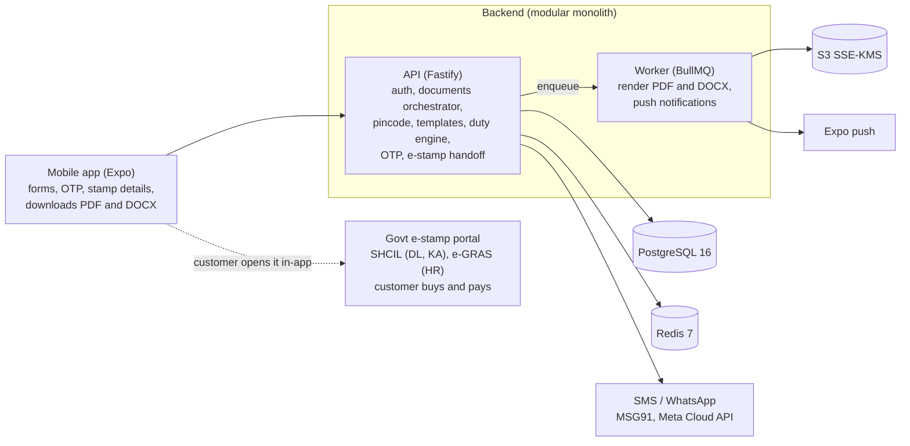
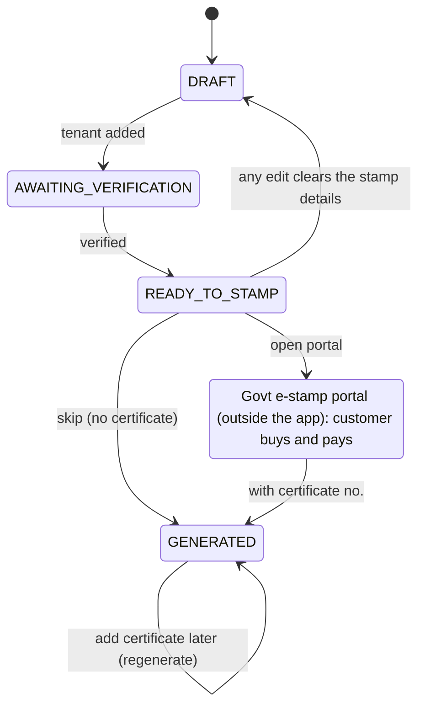

# LegalKart — System Design

Source of truth: the editable Claude Doc at https://claude.ai/artifact/7BFeGdb8L7tSs2Gv5CW1YP. This file is a snapshot of it (15 Nov 2026) kept in the repo as context for code changes. When the two disagree, update this file from the doc.

## Purpose and scope

This design is the target architecture for rebuilding LegalKart into a shippable mobile product, and the shared context for every later change. It covers the mobile app, the backend services, data, integrations and infra. It replaces the parts of `docs/SPEC.md` it overlaps.

**Goal of the rebuild:** a landlord in NCR or Bengaluru goes from property pincode to a ready-to-sign rent agreement in under 10 minutes, on Android and iOS.

**E-stamp model:** LegalKart does not buy e-stamps or take money. The app works out the exact stamp to buy, sends the customer to the official government portal to buy and pay there, then lets them add the certificate number or just download the agreement.

**In scope now**

- Mobile app: real Expo project, every screen of the rent agreement journey, designed first as a Claude artifact
- Backend: the existing services hardened one by one (Postgres, auth, jobs, storage, real vendors)
- One document type end to end: Residential Rent Agreement (DL, HR, KA)

**Out of scope for this design**

- Other document types, brokers, advocate marketplace (Phase 2+ in the spec)
- Buying e-stamps, collecting stamp duty, refunds, reconciliation
- In-app payments: a ₹10 per-document fee is planned but switched off
- The unrelated ENT clinic site at the repo root, to be deleted
- Web app and ops console

## Current state and what to fix

The backend flow works end to end in sandbox mode (13 tests pass), but there is no runnable mobile app and nothing is production-grade.

| Area | Today | Fix |
| --- | --- | --- |
| Repo | Done: monorepo at the root, clinic site deleted | – |
| Mobile | One file, `RentAgreementCheckout.tsx`; no Expo project, navigation, or form screens | New Expo app; design every screen in an artifact first |
| Persistence | `MemoryStore`, data lost on restart; `schema.sql` exists but unused | Postgres via Drizzle, migrations |
| Auth | `x-user-id` header stub | Phone OTP login, JWT + refresh token |
| Jobs | E-stamp bought and PDF rendered inside the HTTP request | BullMQ worker for PDF rendering and push |
| Files | Generated PDF/DOCX held in an in-memory map | S3 with SSE-KMS, presigned links |
| E-stamp | Done: stamp details, portal handoff and optional certificate number | Confirm portal steps and certificate formats with one real purchase per state |
| Rates | Illustrative seed rates | Advocate-verified rates; production refuses unverified |
| Payments | Done: removed | Re-add behind a switch when the ₹10 fee is enabled |
| Ops | No console | Not needed at launch: no stamps or money handled |
| Hardening | No rate limiting, no field encryption | `@fastify/rate-limit`, KMS envelope encryption of PII |

## Target architecture

One API process and one worker process serve the mobile app. The customer buys the e-stamp on the government portal from their phone; no stamp purchase or payment passes through our backend.



The API answers fast and enqueues rendering; the worker renders documents and sends push. Both processes share the same Postgres.

## Mobile app

The app is a thin client: it renders forms from the template JSON, calls the API, and downloads files. All legal and money logic stays on the server.

**Stack**

| Concern | Choice | Why |
| --- | --- | --- |
| Framework | Expo (managed), React Native, TypeScript, EAS Build | One codebase for iOS and Android, OTA updates |
| Navigation | Expo Router (file-based) | Deep links |
| Styling | NativeWind (Tailwind classes) — decided | The UI is designed in a Tailwind HTML artifact first, so classes port almost 1:1 |
| Server data | TanStack Query + typed API client from `packages/shared` | Caching, retries, loading states |
| Local state | Zustand, persisted draft id | Resume an unfinished agreement |
| Forms | react-hook-form + zod, generated from the template | Same rules as the server's `validateForm` |
| Portal handoff | `expo-web-browser`, `expo-clipboard` | Opens the government portal in-app; copy buttons for each field to enter there |
| OTP autofill | iOS `oneTimeCode`, Android SMS Retriever | No typing when the party is on the same phone |
| Files | `expo-file-system`, `expo-sharing`, PDF viewer | Download, preview, share the agreement |
| Secrets | `expo-secure-store` | Refresh token |

**Screens (rent agreement journey)**

1. Login: phone number, OTP
2. Home: start a document, list of my documents with status
3. Property: pincode, confirm Sub-Registrar Office if ambiguous
4. Agreement details: rent, deposit, term, start date, property address (dynamic form)
5. Parties: landlords, tenants, witnesses; "This is me"
6. Tenant verification: OTP card per tenant, SMS or WhatsApp, resend timer
7. Draft preview: watermarked agreement
8. Stamp details: duty amount with its basis, the portal for this state, every field to enter with a copy button, disclaimer, "Open government portal"
9. Add certificate: enter the certificate number, or skip and download without it
10. Done: view, download, share PDF and DOCX; add a certificate number later to regenerate
11. Profile: saved details for autofill

**Rules**

- The app never computes duty, never builds the PDF, never decides a document's status. It shows what the API returns.
- Every screen maps to a document status, so reopening the app lands on the right step.
- UI is designed in a Claude artifact first; the approved design is then ported to components.

## Backend services

The backend stays a modular monolith: one Fastify API process plus one worker process, sharing code by module. Each module owns its tables and exposes a TypeScript interface; no module reads another's tables directly.

| # | Service (module) | Owns | Key responsibilities | Status today |
| --- | --- | --- | --- | --- |
| 1 | Auth | `users`, refresh tokens | Phone OTP login, JWT (15 min), rotating refresh (30 days), ownership checks | Stub (`x-user-id`) |
| 2 | Profile | `user_profiles`, `saved_contacts` | Saved details, autofill for forms and "This is me" | Not built |
| 3 | Pincode | `pincodes`, `pincode_sro_map`, districts, SROs | Pincode → state, district, area type, SRO; auto-select at confidence ≥ 80 | Built, in-memory |
| 4 | Templates | `templates`, `document_types` | Load and version templates, JSON Schema check, form validation, `showIf` | Built, file-based |
| 5 | Documents (orchestrator) | `documents`, `document_parties` | The status machine; calls every other service in order | Built; states change |
| 6 | Verification (OTP) | `party_verifications` | Party OTP send and verify, throttles, WhatsApp → SMS fallback, consent log | Built, console provider |
| 7 | Duty engine | `stamp_rates`, `circle_rates` | Rate selection, duty bases, rounding; tells the customer exactly what stamp to buy | Built |
| 8 | E-stamp handoff | `estamp_portals`, certificate fields on `documents` | Per-state portal link and steps; builds the field list to enter on the portal; checks certificate number format | Built, in-memory |
| 9 | Rendering | `document_outputs` | HTML → PDF (Chromium), footer with certificate number or "attach e-stamp" note, QR, DOCX, SHA-256 | Built, runs in request |
| 10 | Storage | S3 bucket | Upload outputs, presigned download links | Not built (in-memory map) |
| 11 | Notifications | device tokens | Push "Your agreement is ready", reminders to add a certificate | Not built |
| 12 | Billing (off) | `payments` | ₹10 per-document fee via Razorpay, behind a switch that stays off | Removed; re-add when the fee is enabled |

**Removed from today's code:** Razorpay capture before stamping, e-stamp vendor adapters (sandbox, aggregator, manual ops), purchase polling, refunds.

**Worker process (BullMQ queues):** `document.render`, `notify.push`. The API only enqueues; the worker renders documents and sends notifications.

## Data model and storage

PostgreSQL 16 is the source of truth, starting from the existing `packages/db/schema.sql`, ported to Drizzle migrations.

| Store | Holds | Notes |
| --- | --- | --- |
| PostgreSQL 16 | Users, documents, parties, verifications, rates, portal config, certificate numbers, outputs, audit log | Money in paise (`BIGINT`), rates in basis points; exclusion constraint stops overlapping rate rows |
| Redis 7 | OTP throttles, pincode cache (24 h), idempotency locks, BullMQ queues | Nothing here is the only copy of business data |
| S3 (Mumbai) | Agreement PDFs and DOCX | SSE-KMS, Object Lock on issued documents, presigned links of a few minutes |

**Invariants enforced in the database, not only in code**

- One live OTP challenge per party (partial unique index)
- Only one primary SRO per pincode
- A certificate number, when given, matches its state's format and is unique per state
- Every generated file records the duty quote and certificate number it was made with

**Personal data:** names, phones and addresses are envelope-encrypted (`*_enc` columns). Full Aadhaar numbers are never stored, only the last 4 digits. Each generated file stores the frozen instance JSON so it can be re-rendered byte for byte.

## Core flow: rent agreement

Every document moves through one status machine owned by the Documents service; each API call first checks the current status, so steps cannot run out of order.



The customer can leave for the government portal and come back any time; the draft and stamp details are saved. Adding a certificate number later regenerates the files with it on every page.

**Guards at each step**

1. Create draft: pincode resolves to one supported state; jurisdiction frozen on the document.
2. Stamp details: form valid, minimum parties present, every tenant verified, disclaimer acknowledged; duty calculated from verified rates and saved with the date and rates used.
3. Portal handoff: the app shows the state's portal and every field to enter (article, duty amount, first party, second party, duty paid by, property). Nothing is sent to the portal by us.
4. Certificate number (optional): format check for that state only; LegalKart never states the stamp is verified.
5. Generate: tenant verification still valid; certificate number in the footer, or an "attach e-stamp before signing" note; output SHA-256 stored.

## External integrations

Every vendor sits behind an adapter interface with a sandbox implementation, so the app runs end to end with no accounts and switches by environment variable.

| Integration | Primary | Fallback | Sandbox | Before launch |
| --- | --- | --- | --- | --- |
| SMS OTP | MSG91 (TRAI DLT template) | Gupshup / Kaleyra | Console provider | DLT entity, sender header, content template |
| WhatsApp OTP | Meta WhatsApp Cloud API, authentication template | SMS | Console provider | WhatsApp Business verification, template approval |
| E-stamp: Delhi, Karnataka | SHCIL portal (shcilestamp.com), customer pays online and prints at home | Buy at an SHCIL collection centre | Link only | One test purchase per state to confirm steps and fields |
| E-stamp: Haryana | State e-GRAS portal (egrashry.nic.in), customer pays online and prints at home | Licensed stamp vendor | Link only | One test purchase to confirm steps and fields |
| Payments (off) | Razorpay, for the ₹10 fee when switched on | – | Fake gateway | Razorpay KYC, only when the fee is enabled |
| Pincode data | India Post directory (data.gov.in) + LGD codes | Manual state picker | Seed rows | Curated pincode → SRO map for launch cities |
| Push | Expo push notifications | In-app status | Logged only | Apple and Google developer accounts |

**E-stamp portals have no public API.** We cannot pre-fill them or confirm a purchase. We only link to the official portal, give the customer every field to enter, and never automate or scrape the portal on their behalf.

## Security, compliance and money

**Money**

- LegalKart never collects stamp duty; the customer pays the government directly on the portal.
- No in-app payment at launch. The ₹10 per-document fee sits behind a switch that stays off until decided.
- Duty is still calculated in integer paise and basis points, rounded up, from verified rates. The amount we show must be the amount the portal asks for, or the agreement is under-stamped.
- Any edit after the stamp details are shown clears them and recalculates.

**Security**

- OTPs: CSPRNG, only an HMAC stored, constant-time compare, 5-minute expiry, 5 attempts, per-phone hourly cap.
- Every document route checks the caller owns the document.
- Rate limits per IP, per phone, per user at the API edge.
- Secrets in AWS Secrets Manager; no secrets in the app bundle.

**Compliance**

- Disclaimer acknowledged before stamp details are shown; LegalKart is not a law firm.
- Stamp-duty rates come only from verified rows; production refuses unverified ones. The stamp details show the legal article and basis.
- We never claim to have verified a certificate. The PDF tells parties to verify the number on the official portal.
- An agreement downloaded without a certificate number carries a note: "Attach the e-stamp certificate before signing."
- DPDP Act: consent logged per party with notice version; data stored in India; retention and deletion APIs.
- No e-sign for leases or sale documents until counsel confirms; wet-ink signature blocks.
- SMS content matches the registered DLT template exactly.

## Infra, deployment and observability

Everything runs in AWS Mumbai (`ap-south-1`) so personal data stays in India.

| Layer | Choice |
| --- | --- |
| Compute | ECS Fargate: `api` service, `worker` service, `renderer` (Chromium) service |
| Data | RDS PostgreSQL 16 Multi-AZ, ElastiCache Redis 7, S3 with SSE-KMS |
| Edge | ALB + WAF; CloudFront for the public verify page |
| Infra as code | Terraform |
| Environments | `local` (Docker Compose: Postgres, Redis, MinIO), `staging` (sandbox vendors), `production` |
| CI | GitHub Actions: typecheck, lint, tests, template schema check, migration dry-run |
| Mobile builds | EAS Build and EAS Submit; OTA updates through EAS Update |
| Observability | OpenTelemetry traces, Sentry (app + API), structured logs; alerts on OTP delivery rate and failed renders |

**Local development must need no vendor accounts:** `docker compose up` plus `npm run dev` gives a working API with sandbox OTP, and the Expo app points at it.

## Repo structure

One npm-workspaces monorepo at the repo root, replacing the clinic site. Shared types and the template schemas live in one package so the app and the API cannot drift.

```
apps/
  mobile/          Expo app (Expo Router, NativeWind)
  api/             Fastify API (from legalkart/server)
  worker/          BullMQ workers (same code, different entry point)
packages/
  shared/          zod schemas, API types, money helpers, status enums
  templates/       template JSON + JSON Schemas (from legalkart/templates, schemas)
  db/              Drizzle schema + migrations (from legalkart/db)
design/
  ui/              artifact HTML exports of approved screens
docs/              SYSTEM-DESIGN.md (this doc), SPEC.md, user guide, marketing plan
infra/             Terraform, docker-compose.yml
```

The API and worker share modules under `apps/api/src/modules/<service>`; the worker imports them rather than duplicating code.

## Execution plan

Work goes in three steps; each step ends with code merged and this doc updated. UI design (screens and tokens) runs in parallel in a separate session on branch `claude/legalkart-ui-design`.

**Step 1: system design (this doc)**

- [x] Owner reviews and edits this doc
- [x] Commit it as `docs/SYSTEM-DESIGN.md` and use it as context for all later work

**Step 2: mobile app**

- [x] Restructure the repo into the monorepo layout; remove the clinic site
- [ ] Design system in an artifact: colours, type, buttons, inputs, cards, status chips
- [ ] Design every screen of the journey in the artifact; iterate until approved
- [ ] Scaffold the Expo app (Router, NativeWind, TanStack Query, typed API client)
- [ ] Port approved screens one by one, wired to the sandbox API
- [ ] Government portal handoff with copy buttons, OTP autofill, file download and share
- [ ] EAS development build on Android and iOS

**Step 3: backend, service by service**

- [ ] Postgres + Drizzle migrations; replace `MemoryStore` (unblocks everything below)
- [x] Remove stamp purchase, Razorpay capture and refund code (billing to be re-added behind a switch when the fee is enabled)
- [ ] Auth: phone OTP login, JWT, ownership checks
- [ ] Pincode: import India Post data, curated SRO map for launch cities
- [ ] Templates: store versions in the database
- [ ] Verification: real MSG91 and WhatsApp adapters, DLR webhook
- [ ] Duty engine: load verified rates, maker-checker rate edits
- [x] E-stamp handoff: per-state portal config, stamp details, certificate number entry and format check (in memory; moves to Postgres with the rest)
- [ ] Rendering + storage: render worker, S3, presigned links, regenerate when a certificate is added
- [ ] Notifications: push when ready, reminder to add a certificate
- [ ] Hardening: rate limits, field encryption, observability

## Decisions

| Decision | Choice | Alternatives |
| --- | --- | --- |
| Styling library for the app | NativeWind (decided) | Tamagui, React Native Paper, plain StyleSheet |
| App languages at launch | English only | English + Hindi |
| Fee per document | Off at launch | ₹10 per document via Razorpay; other pricing |
| How the tenant enters the OTP | Tenant reads the code to the landlord (decided) | Tenant opens a deep link on their own phone |
| E-stamp route | Customer buys on the government portal (decided): SHCIL for DL and KA, e-GRAS for HR | Karnataka's Kaveri portal instead of SHCIL |
| Backend shape | Modular monolith (API + worker) | Separate services per module |
| ORM | Drizzle | Kysely, Prisma |
| Cloud | AWS Mumbai | GCP Mumbai |
| Repo root clinic site | Delete (decided) | Move to its own repo |
