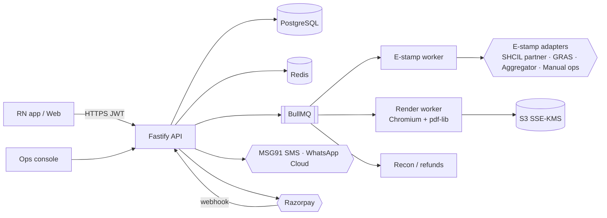
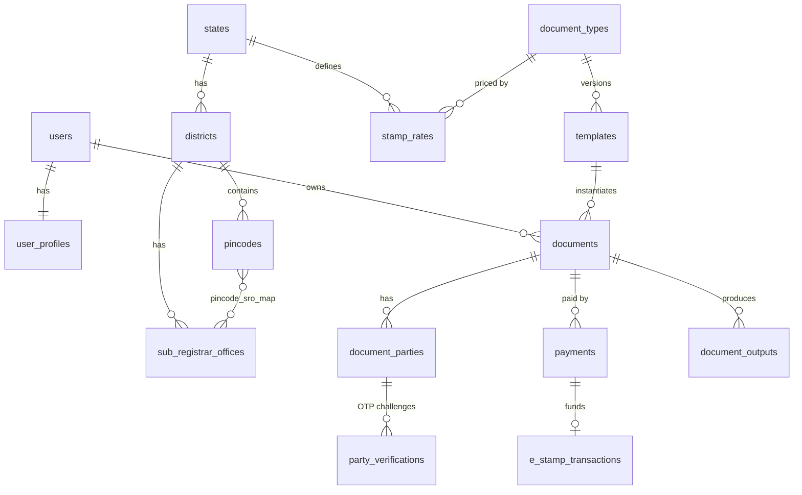
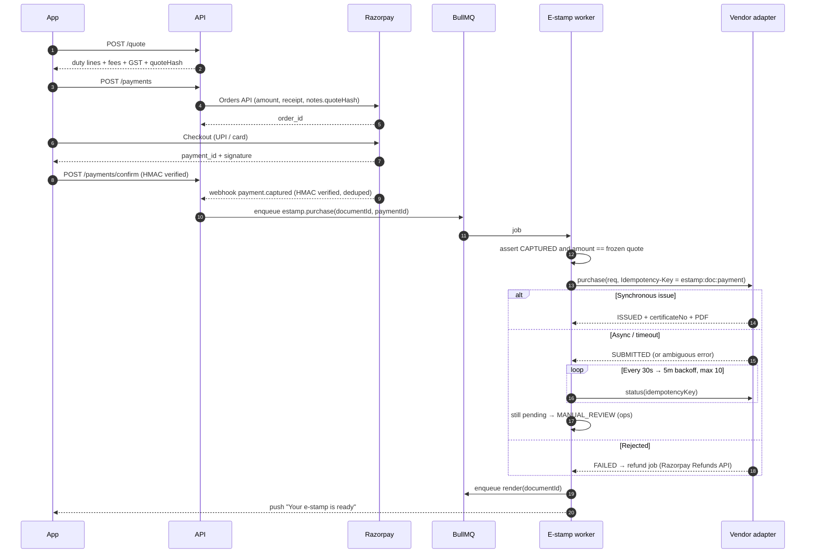
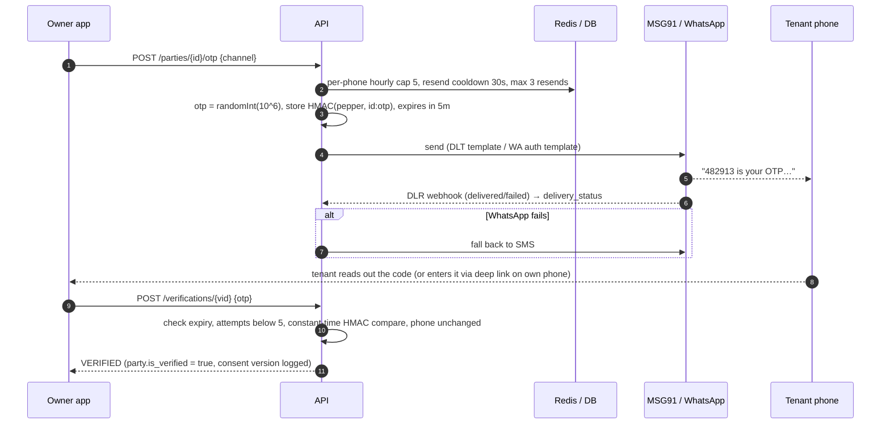
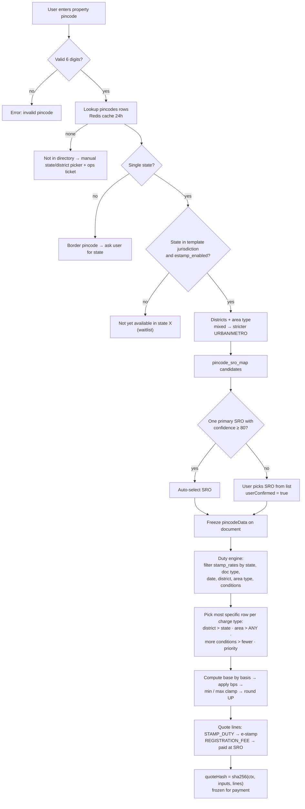

# LegalKart Paper Generator — Product & Technical Specification

**Version:** 1.0 · **Date:** 16 Oct 2026 · **Market:** India

**What it does:** anyone can produce a ready-to-sign property document (a rent agreement, an agreement to sell, an affidavit and so on) by entering the parties' details. The app:
1. Maps the property pincode to its state, district, Sub-Registrar Office and stamp duty.
2. Verifies tenants and buyers by OTP.
3. Buys the correct e-stamp online.
4. Outputs a stamped PDF and an editable DOCX.

> **Legal disclaimer:** all stamp-duty figures in this repository are **illustrative placeholders**. Rates must be taken from state notifications and signed off by an advocate before launch (see [Compliance](#8-compliance-legal--risk-register)).

---

## Contents

0. [Repository map](#0-repository-map)
1. [Product scope](#1-product-scope): users, document catalogue, feature requirements
2. [(a) Tech stack](#2-a-tech-stack)
3. [(b) Database schema](#3-b-database-schema)
4. [(c) Integration flows](#4-c-integration-flows): e-stamp, OTP, pincode → rate mapping
5. [(d) Template JSON Schema](#5-d-template-json-schema)
6. [(e) Build plan: MVP → Phase 2 → Phase 3](#6-e-build-plan)
7. [(f) Sample code: Rent Agreement with OTP + e-stamp](#7-f-sample-code)
8. [Compliance, legal and risk register](#8-compliance-legal--risk-register)
9. [API reference](#9-api-reference)

---

## 0. Repository map

| Path | What it is |
|---|---|
| `SPEC.md` | This document |
| `db/schema.sql` | PostgreSQL 16 schema. Includes the 4 new tables: `pincodes`, `stamp_rates`, `e_stamp_transactions`, `party_verifications`. Tested by loading into Postgres 16 |
| `db/seed.sql` | Development seed (DL, HR, KA, MH). The rates in it are illustrative |
| `schemas/document-template.schema.json` | JSON Schema for templates: form, parties, OTP policy, pincode binding, duty inputs, e-stamp mapping, clauses, output |
| `schemas/document-instance.schema.json` | JSON Schema for a filled document: verification status, `pincodeData`, `dutyQuote`, `eStamp` |
| `templates/rent-agreement.residential.json` | A production-shaped Rent Agreement template (DL/HR/KA) |
| `server/` | Reference backend in TypeScript/Fastify: pincode resolver, duty engine, OTP, e-stamp adapters, Razorpay, PDF/DOCX. Has 13 tests |
| `mobile/RentAgreementCheckout.tsx` | React Native screens: party OTP card and e-stamp checkout |
| `samples/` | Output of `npm run demo`: stamped PDF (sandbox certificate), DOCX, HTML and an instance JSON |

---

## 1. Product scope

### 1.1 Users

| Persona | Need |
|---|---|
| **Landlord / owner** (primary payer in the MVP) | A valid rent agreement in 10 minutes, with no trip to a stamp vendor |
| **Tenant** | Proof of address, a basis for HRA claims, and assurance that the paper is genuine. Verifies by OTP |
| **Buyer / seller** | A draft agreement to sell or a token-money receipt, on correct-value stamp paper |
| **Broker / property manager** (Phase 2) | Many agreements a month: saved parties, bulk generation, a wallet |
| **Ops agent** (internal) | Fulfils manual e-stamps, curates pincode-to-SRO mappings, reconciles payments |
| **Advocate partner** (Phase 2) | Paid review of a draft before signing |

### 1.2 Document catalogue

*The brief refers to a "previous list" that isn't available in this context, so the catalogue below is a reconstruction for Indian property transactions. Adjust it if the original list differs.*

| # | Document | Category | E-stamp | Registration | Mandatory OTP roles | Aadhaar e-sign allowed?¹ | Phase |
|---|---|---|---|---|---|---|---|
| 1 | Residential Rent Agreement (≤ 11 months) | Rental | ✔ | Optional (compulsory if > 11 months) | Tenant | ✘ (counsel to confirm) | **MVP** |
| 2 | Leave & Licence Agreement (Maharashtra) | Rental | ✔ | **Compulsory**, any term (s.55 MRC Act) | Licensee | ✘ | P2 |
| 3 | Commercial Lease Deed | Rental | ✔ | If > 11 months | Tenant | ✘ | P2 |
| 4 | Rent Receipt | Rental | Revenue stamp if cash > ₹5,000 | – | – | ✔ | **MVP** |
| 5 | Lease Termination / Surrender Letter | Rental | Varies | – | Tenant | ✔ | P2 |
| 6 | Agreement to Sell | Sale | ✔ | State-dependent² | Buyer | ✘ | **MVP** (draft + e-stamp) |
| 7 | Sale Deed (Conveyance) | Sale | ✔ | **Compulsory** | Buyer | ✘ | P3 (prepare + book SRO slot) |
| 8 | Token / Booking Receipt (Bayana) | Sale | ✔ (state-specific) | – | Buyer | ✘ | P2 |
| 9 | Possession Letter | Sale | Varies | – | Buyer | ✔ | P2 |
| 10 | Gift Deed | Transfer | ✔ | **Compulsory** | Donee | ✘ | P3 |
| 11 | Release / Relinquishment Deed | Transfer | ✔ | **Compulsory** | Releasee | ✘ | P3 |
| 12 | Partition Deed / Family Settlement Memo | Transfer | ✔ | Compulsory / varies | All | ✘ | P3 |
| 13 | General Power of Attorney | Authority | ✔ | Compulsory for immovable-property sale in many states | Attorney | ✘ (IT Act excluded) | P2 |
| 14 | Special Power of Attorney | Authority | ✔ | Varies | Attorney | ✘ | P2 |
| 15 | Revocation of POA | Authority | ✔ | If original registered | – | ✘ | P3 |
| 16 | Mortgage Deed / Memorandum of Deposit of Title Deeds | Finance | ✔ | Varies | – | ✘ | P3 |
| 17 | General Affidavit (address, name, income) | Declaration | ✔ (small fixed) | – (notary / oath commissioner) | Deponent (self) | ✘ | **MVP** |
| 18 | Indemnity Bond | Declaration | ✔ | – | – | ✔ | P2 |
| 19 | NOC (society or owner, for electricity, GST or passport) | Declaration | Plain paper or small stamp | – | – | ✔ | **MVP** |
| 20 | Will | Declaration | No stamp duty | Optional | – | ✘ (IT Act excluded) | P3 |

¹ Under the IT Act 2000, First Schedule, electronic signatures are **not valid** for a power of attorney, a trust, a will, or "any contract for sale or conveyance of immovable property or any interest in such property". A lease is a transfer of an interest in immovable property, so leases default to **wet-ink signatures** until counsel gives an opinion.
² Some states (e.g. Maharashtra) require an agreement to sell that involves possession to be stamped like a conveyance.

### 1.3 Feature requirements (mapped to the brief)

| # | Requirement | How it is met |
|---|---|---|
| 1 | Smart dynamic forms with per-document schemas | Each template defines `sections[].fields[]` with types, validation, `showIf` conditions and repeaters. The app renders the form from the JSON. The server re-validates with the same rules (`validateForm`) |
| 2 | Profile with auto-fill | `user_profiles` plus `saved_contacts`. A field's `autofillFrom: "profile.fullName"` pulls from the profile, and "This is me" fills a whole party from the profile |
| 3 | Multi-party management with OTP for tenants and buyers | `document_parties` enforces min/max per role from the template. Roles in `verification.requiredRoles` get `otp_required = true`, and the quote is **blocked** until they verify. Changing a party's phone resets verification |
| 4 | State and pincode selection | Pincode → candidate post offices, districts and SROs. Auto-selects when one primary SRO has confidence ≥ 80; otherwise the user picks. The result drives `stamp_rates` lookup and the registration fee |
| 5 | E-stamp purchase | Pay (Razorpay) → `EStampService` → provider adapter (SHCIL partner, state GRAS, aggregator, or manual ops) → certificate number stored → printed on every page |
| 6 | Templates in legal English, state-compliant | Clauses can be state-scoped (`states: ["DL","HR"]`). Templates are versioned and go through `LEGAL_REVIEW` before `PUBLISHED` |
| 7 | Output: stamped PDF and editable DOCX | Puppeteer/Playwright renders HTML to PDF; pdf-lib puts the certificate first and adds a footer with the certificate number, page *x* of *y* and a verification QR; `docx` builds the Word file with signature blocks |
| 8 | Disclaimer and lawyer review | The user must acknowledge the disclaimer before paying (`consents` row). The "Get it reviewed by an advocate" upsell arrives in Phase 2 |

### 1.4 End-to-end user journey (Rent Agreement)

```
Home ─▶ Choose "Rent Agreement" ─▶ Property pincode ─▶ [confirm SRO if ambiguous]
     ─▶ Property & rent form (auto-filled from profile where possible)
     ─▶ Add landlord(s), tenant(s), witnesses
     ─▶ Tenant OTP (SMS / WhatsApp)  ── blocked until verified
     ─▶ Draft preview (watermarked "DRAFT — NOT STAMPED")
     ─▶ Duty quote + fees + GST ─▶ acknowledge disclaimer ─▶ Pay (UPI/card/netbanking)
     ─▶ E-stamp issued (cert no.) ─▶ Stamped PDF + DOCX ─▶ Print, sign in ink, (notarise)
```

---

## 2. (a) Tech stack

| Layer | Choice | Why / notes |
|---|---|---|
| **Mobile app** | React Native 0.8x + Expo (EAS Build), TypeScript, Expo Router | One codebase for iOS and Android. Shares zod types and form logic with the backend. OTA updates for template-driven UI |
| Forms | react-hook-form + zod, generated from the template JSON | Dynamic per-document schemas |
| State and data | TanStack Query, Zustand | Server cache; offline draft persistence |
| OTP autofill | iOS `textContentType="oneTimeCode"`; Android SMS Retriever (`react-native-otp-verify`, 11-char app hash in the DLT template) | No manual typing when the party is on the same phone |
| Payments SDK | `react-native-razorpay` (UPI intent, cards, netbanking) | |
| PDF viewer | `react-native-pdf` | In-app preview |
| Secure storage | `expo-secure-store` (Keychain / Keystore) | Refresh token |
| **Web** (optional) | React + Vite (consistent with this repo), same API | Desktop users and brokers |
| Admin / ops console | React + Vite + TanStack Table, behind Google SSO | Manual e-stamps, SRO curation, rate editor with 4-eyes approval |
| **Backend API** | Node.js 22 LTS, TypeScript, **Fastify 5**, zod | Fast, schema-first. The sample in `server/` uses this stack |
| ORM / SQL | Drizzle ORM or Kysely over `pg` | Typed SQL; migrations via drizzle-kit |
| Jobs | **BullMQ** on Redis | E-stamp purchase, status polling, PDF rendering, refunds, reconciliation, rate-change alerts |
| Database | **PostgreSQL 16** (AWS RDS, Mumbai `ap-south-1`, Multi-AZ) with `pg_trgm`, `btree_gist`, `citext` | Exclusion constraint prevents overlapping stamp-rate rows |
| Cache / rate limits | Redis 7 (ElastiCache) | OTP throttles, pincode cache, idempotency locks |
| Object storage | S3 (`ap-south-1`) with SSE-KMS, Object Lock on issued documents, short-lived presigned URLs | Data localisation and tamper evidence |
| Document rendering | Handlebars → HTML → **headless Chromium** (Playwright/Puppeteer) → PDF; **pdf-lib** to merge and stamp; **qrcode**; **docx** for Word | Pixel-identical PDF and editable DOCX from one model. Noto Serif / Noto Sans Devanagari fonts for regional languages |
| **Payment gateway** | **Razorpay** (primary), **Cashfree** or **PayU** (fallback) | UPI, cards, netbanking. Orders API with webhooks (`payment.captured`, `refund.processed`) and the Refunds API. Government duty and the taxable fee are accounted separately |
| **SMS gateway** | **MSG91** (primary), Gupshup or Kaleyra (fallback). All via **TRAI DLT** (entity ID, sender header e.g. `LGLKRT`, content template ID) | DLT is mandatory for commercial SMS in India |
| WhatsApp OTP | **WhatsApp Business Cloud API** (Meta), or a BSP such as Gupshup or Interakt; *authentication* category template with a copy-code button | Higher delivery rates; falls back to SMS |
| **E-stamp** | Adapter layer: SHCIL partner/ACC integration, state GRAS portals (Maharashtra GRAS, Haryana e-GRAS), licensed aggregators (e.g. stamp2india-type vendors, under contract), and a **manual-ops** fallback | See §4.1. There is no open public SHCIL purchase API |
| **Pincode database** | **India Post All-India Pincode Directory** (data.gov.in, OGD licence) + **LGD** codes (Local Government Directory) + a curated pincode → SRO table from state IGR portals | Refreshed monthly. Unofficial public pincode APIs are used only as a fallback lookup, never as the source of truth |
| Identity (Phase 2) | DigiLocker (issued documents), PAN verification (via a KYC provider), **Aadhaar eSign** through a licensed ESP (e.g. eMudhra, Protean/NSDL e-Gov, C-DAC) for documents where e-sign is permitted | |
| Auth | Phone OTP login (same OTP service), JWT access token (15 min) + rotating refresh token (30 days) | |
| Infra | AWS Mumbai: ECS Fargate (API, workers, renderer), ALB + WAF, CloudFront, Secrets Manager, KMS; Terraform | Data stays in India (DPDP Act and RBI expectations) |
| Observability | OpenTelemetry → Grafana/Tempo/Loki, Sentry (app and API), PagerDuty | SLOs on OTP delivery, e-stamp latency and PDF generation |
| CI/CD | GitHub Actions (typecheck, tests, schema validation of every template, SQL migration dry-run), EAS for mobile | |
| Analytics | PostHog (self-hosted in India) | Funnel: pincode → form → OTP → pay → stamped |

### 2.1 Architecture



---

## 3. (b) Database schema

The full DDL is in [`db/schema.sql`](db/schema.sql) and has been tested on PostgreSQL 16. Conventions:
- Money is stored as **paise in `BIGINT`**.
- Rates are stored in **basis points**.
- PII is envelope-encrypted (`*_enc`).
- **Full Aadhaar numbers are never stored**; only the last 4 digits.

### 3.1 Entity map



### 3.2 The four new tables

**`pincodes`**: one row per (pincode, post office). Seeded from the India Post directory.

| Column | Notes |
|---|---|
| `pincode CHAR(6)` | `CHECK ~ '^[1-9][0-9]{5}$'` |
| `office_name`, `office_type` (HO/SO/BO), `delivery` | From India Post |
| `district_id → districts`, `state_code → states` | Joined to LGD codes |
| `area_type` | Curated (URBAN / RURAL / METRO …). Drives area-specific duty |
| `latitude`, `longitude`, `source`, `source_updated_on` | For freshness tracking |

Companion table `pincode_sro_map(pincode, sro_id, is_primary, confidence)`. A partial unique index allows only one primary per pincode. Confidence below 80 makes the app ask the user to confirm.

**`stamp_rates`**: data-driven duty and fee rules. Rates live here, never in code or templates.

| Column | Notes |
|---|---|
| `state_code`, `district_id` (NULL = state-wide), `area_type` | Scope |
| `document_type`, `charge_type` | `STAMP_DUTY`, `REGISTRATION_FEE`, `SURCHARGE`, `CESS` … |
| `basis` | `FIXED`, `CONSIDERATION`, `MAX_CONSIDERATION_MARKET_VALUE`, `AVG_ANNUAL_RENT_PLUS_DEPOSIT`, `TOTAL_RENT_PLUS_DEPOSIT`, `MH_LEAVE_AND_LICENCE`, `SLAB` |
| `rate_bps`, `fixed_amount_paise`, `min_amount_paise`, `max_amount_paise`, `slabs JSONB` | Amounts |
| `conditions JSONB` | e.g. `{"buyerGender":"FEMALE"}`, `{"maxTermMonths":11}` |
| `rounding_unit_paise`, `priority` | Rounding (always up) and tie-break |
| `effective_from`, `effective_to` | **Exclusion constraint** so no two rows for the same scope and conditions overlap in time |
| `source_ref`, `verified_by`, `verified_at` | Legal provenance. Production refuses to quote from an unverified row |

**`e_stamp_transactions`**: one per purchase.

| Column | Notes |
|---|---|
| `idempotency_key UNIQUE` | `estamp:<documentId>:<paymentId>`. Sent to the vendor; retries reuse it |
| `provider`, `provider_request_id`, `status` | State machine in §4.1 |
| `fulfilment_mode` | `DIGITAL_SELF_PRINT` / `ACC_PRINT_COURIER` / `ACC_PICKUP` / `FRANKING` |
| `article_code`, `description_of_document`, `property_description`, `consideration_paise`, `stamp_duty_paise`, `first_party_name`, `second_party_name`, `duty_paid_by`, `purchased_by` | Exactly the fields printed on an e-stamp certificate |
| `certificate_no UNIQUE`, `unique_doc_reference`, `issued_at`, `acc_code`, `certificate_file_key`, `verification_url` | Issued certificate. `CHECK (status <> 'ISSUED' OR certificate_no IS NOT NULL)` |
| `raw_request`, `raw_response` (redacted), `attempt_count`, `next_poll_at`, `failure_reason` | Audit and polling |

A partial unique index allows **only one active stamp per document**.

**`party_verifications`**: one row per OTP challenge.

| Column | Notes |
|---|---|
| `party_id`, `document_id`, `phone_e164`, `channel` | |
| `otp_hmac` | HMAC-SHA256(pepper, `id:otp`). **The plaintext OTP is never stored** |
| `attempts`, `max_attempts`, `resend_count`, `status` | `PENDING → SENT → VERIFIED / LOCKED / EXPIRED / FAILED` |
| `provider`, `provider_message_id`, `dlt_template_id`, `delivery_status` | Delivery receipts (DLR) |
| `expires_at`, `verified_at`, `consent_text_version`, `request_ip`, `user_agent` | Evidence that the party consented |

A partial unique index allows **one live challenge per party**.

### 3.3 Key queries

```sql
-- Pincode → jurisdiction
SELECT p.office_name, p.area_type, d.name AS district, s.code, s.name, s.estamp_enabled
FROM pincodes p JOIN districts d ON d.id = p.district_id JOIN states s ON s.code = p.state_code
WHERE p.pincode = $1;

-- Candidate rate rows (the engine then picks the most specific in code)
SELECT * FROM stamp_rates
WHERE state_code = $1 AND document_type = $2
  AND effective_from <= $3 AND (effective_to IS NULL OR effective_to >= $3)
  AND (district_id IS NULL OR district_id = $4)
  AND area_type IN ('ANY', $5);

-- Stuck e-stamps for the poller
SELECT id FROM e_stamp_transactions
WHERE status IN ('SUBMITTED','MANUAL_REVIEW') AND next_poll_at <= now()
ORDER BY next_poll_at LIMIT 100 FOR UPDATE SKIP LOCKED;
```

---

## 4. (c) Integration flows

### 4.1 E-stamp purchase (SHCIL / StockHolding / state portals / aggregators)

**Market reality.** *SHCIL* and *StockHolding* are the same entity: Stock Holding Corporation of India Ltd. It is the **Central Record Keeping Agency (CRA)** for e-stamping in most states that use e-stamps. There is **no open, self-serve public purchase API**, so integration is commercial. Options, in order of preference per state:

| Route | How | Typical use |
|---|---|---|
| **SHCIL partner / ACC** | Register as (or partner with) an Authorised Collection Centre. Use the API or partner interface SHCIL provides under agreement | DL, KA, and other SHCIL e-stamp states |
| **State treasury / GRAS** | Pay duty through the state's government receipt portal (e.g. **Maharashtra GRAS** e-SBTR, **Haryana e-GRAS** e-stamp) under that state's rules | MH, HR and similar |
| **Licensed aggregator** | A contracted vendor (e.g. the *stamp2india*-type providers in the brief) that buys through its own ACC network and returns the certificate | Fast multi-state coverage at launch |
| **Manual ops** (always on) | The order is queued. An ops agent buys at a partner ACC and uploads the scan within an SLA | States with no API, and as a fallback |
| **Franking** (Phase 3) | Through authorised franking banks | High-value deeds |

**Certificate fields.** These map 1:1 to columns in `e_stamp_transactions`:
- Certificate No. (e.g. `IN-DL12345678901234X`)
- Issued date
- Account reference (ACC)
- Unique Doc. Reference
- Purchased by
- Description of document (article)
- Property description
- Consideration price
- First party
- Second party
- Stamp duty paid by
- Stamp duty amount

**Fulfilment.** In some states the certificate must be printed by the ACC on security paper. In others an online, self-printable certificate is allowed. The template's `fulfilmentModes` together with state config decide between `DIGITAL_SELF_PRINT` and `ACC_PRINT_COURIER`. When couriering, the stamped PDF is still produced immediately, with the certificate number in the footer, and the user attaches the original certificate on arrival.



**State machine:**

```
INITIATED ─▶ SUBMITTED ─▶ ISSUED ─▶ (FULFILMENT_PENDING ─▶ DELIVERED)
     │            │  └──▶ MANUAL_REVIEW ─▶ ISSUED (ops upload) / FAILED
     └──▶ FAILED ─▶ REFUND_REQUESTED ─▶ REFUNDED
```

**Safety rules** (implemented in `server/src/estamp/estampService.ts`):
1. A purchase happens only after the payment is `CAPTURED`, and only for the **exact frozen quote**. `payments.duty_quote_hash` must equal `documents.duty_quote_hash`.
2. There is **one idempotency key per (document, payment)**. Webhook replays and app retries can never buy twice. The partial unique index enforces this in the database too.
3. An **ambiguous error** (a timeout or 5xx after sending) is never retried with a new key. The transaction moves to `SUBMITTED` and is resolved by status lookup on the same key.
4. A definite rejection → `FAILED` → automatic refund of the full amount. The refund window for unused or spoiled stamps follows the state's Stamp Act provisions; ops handle vendor-side cancellation.
5. Daily **reconciliation** checks Razorpay settlements against `payments`, and vendor statements against `e_stamp_transactions`. Mismatches open ops tickets.

**Money flow.** Stamp duty is government money collected as a pure pass-through. It is shown as a separate line, carries no GST, and is settled to the vendor or ACC float (Razorpay Route or a separate settlement account; confirm the structure with the PA and an accountant). LegalKart's service fee and the vendor's charge carry **18% GST**, and a tax invoice is issued.

### 4.2 SMS / WhatsApp OTP verification

**Pre-requisites:**
- **TRAI DLT** registration: principal entity, sender header (e.g. `LGLKRT`) and a content template such as:
  `{#var#} is your OTP to confirm your mobile number for a {#var#} on LegalKart. Valid for {#var#} minutes. Do not share it with anyone. -LGLKRT {#var#}`
  (The last variable is the Android SMS Retriever app hash.)
- A **WhatsApp authentication template** with a copy-code button, approved by Meta.



**Rules** (in `server/src/otp/otpService.ts`):
- The code is 6 digits from a CSPRNG, valid for 5 minutes.
- After **5 wrong attempts** the challenge is `LOCKED`.
- Only one live challenge exists per party; a new send supersedes the old one.
- **If the phone number changes, the party must verify again.** Generation also re-checks.
- Throttles stop SMS pumping: at most 5 sends per phone per hour, plus IP and device limits at the gateway.
- Only the HMAC of the code is stored, so a database leak cannot replay codes.
- Entering the OTP also records the party's **consent** (DPDP notice version) to processing their name and number for this document.
- The document records "Mobile +91******0002 verified via SMS OTP on <date> IST" under the party's signature block.
- **Limitation:** OTP proves control of a phone number, **not identity**. Phase 2 adds DigiLocker/Aadhaar-based KYC for buyers.

### 4.3 Pincode → state → rate mapping logic



**Duty bases:**
- `FIXED`: a flat amount.
- `CONSIDERATION`: rate × consideration.
- `MAX_CONSIDERATION_MARKET_VALUE`: rate × max(consideration, circle-rate value), from the `circle_rates` table.
- `AVG_ANNUAL_RENT_PLUS_DEPOSIT`: for terms of 12 months or less, rate × (rent for the whole term + deposit); for longer terms, rate × (12 × rent + deposit).
- `TOTAL_RENT_PLUS_DEPOSIT`: rate × (rent × term + deposit).
- `MH_LEAVE_AND_LICENCE`: rate × (licence fee × term + 10% p.a. notional interest on the deposit).
- `SLAB`: bracket rates.

Unknown condition keys **never match**, so a rule the engine doesn't understand is never applied silently.

**Worked example** (illustrative seed, Gurugram 122001, rent ₹25,000 × 11 months, deposit ₹50,000):

| Line | Amount |
|---|---|
| Stamp duty, HR, 1.5% × (₹2,75,000 + ₹50,000) | ₹4,875 |
| Service fee | ₹199 |
| E-stamp vendor charge | ₹50 |
| GST 18% on ₹249 | ₹44.82 |
| **Total** | **₹5,168.82** |

**Rate maintenance:**
- Rates are edited only in the ops console, with **maker-checker** approval.
- A new notification becomes a new row with `effective_from`; the old row gets an `effective_to`. The exclusion constraint rejects overlaps.
- A weekly job diffs state IGR pages and alerts legal ops to changes.

---

## 5. (d) Template JSON Schema

There are two schemas:

- [`schemas/document-template.schema.json`](schemas/document-template.schema.json) is the **template definition**: what a lawyer and product team author.
- [`schemas/document-instance.schema.json`](schemas/document-instance.schema.json) is the **filled document snapshot**: the frozen data an output was rendered from. It is stored with every generated file so it can be re-rendered byte for byte.

Template top-level blocks:

| Block | Purpose |
|---|---|
| `jurisdiction` | Allowed and excluded states |
| `legalMeta` | Governing laws, `registration.mandatoryIf` (e.g. term > 11), `eSignPermitted`, `lawyerReviewRecommended`, reviewer |
| `parties[]` | Role, label, min/max, `otpRequired`, `autofillFromProfile`, per-party fields |
| `sections[].fields[]` | Dynamic form: field `type` (text, money, date, pincode, pan, aadhaarLast4, repeater …), `validation`, `showIf`, `autofillFrom`, `pii` |
| `pincodeBinding` | Which field holds the property pincode; what to derive (`state`, `district`, `sro`, `areaType`, `stampRates`, `registrationFee`); whether to lock to the jurisdiction |
| `stampDuty.inputs` | Maps form paths to engine inputs (`monthlyRentPaise → terms.monthlyRent`, …). **No rates here** |
| `eStamp` | `firstPartyRole`, `secondPartyRole`, `dutyPaidByRole`, `descriptionOfDocument`, per-state `articleCodes`, `fulfilmentModes`, `placement.footerText` (certificate number on every page) |
| `verification` | `requiredRoles`, `channels`, OTP length, TTL and attempts, `blockGenerationUntilVerified`, consent text version |
| `body` | Preamble, recitals, clauses (Handlebars text with optional `showIf` / `states`), schedules |
| `signatureBlocks[]` | Per role: photo box, thumb impression, "verified" badge |
| `output` | `formats` (PDF, DOCX), page size, margins, draft watermark, file name |
| `disclaimer` | Text, `requireAcknowledgement` |

Instance `$defs`:
- **`partyVerification`**: `{required, status, channel, verifiedAt, verificationId, consentTextVersion}`. Conditional: when status is `VERIFIED`, `channel`, `verifiedAt` and `verificationId` are required.
- **`pincodeData`**: `{pincode, postOffice, stateCode, stateName, district, districtLgdCode, areaType, sro{code,name}, resolution{confidence, userConfirmed, candidates}}`
- **`dutyQuote`**: `{lines[{chargeType, amountPaise, basis, baseAmountPaise, rateBps, rateId, articleRef, explanation, payableAt}], totalGovtPaise, estampAmountPaise, quoteHash, verifiedRates}`
- **`eStamp`**: `{transactionId, status, provider, fulfilmentMode, certificateNo, uniqueDocReference, issuedAt, accCode, articleCode, descriptionOfDocument, propertyDescription, considerationPaise, stampDutyPaise, firstParty, secondParty, dutyPaidBy, purchasedBy, verificationUrl}`. Conditional: an issued status requires `certificateNo` and `issuedAt`.

An abridged excerpt from [`templates/rent-agreement.residential.json`](templates/rent-agreement.residential.json):

```json
{
  "templateKey": "rent-agreement.residential",
  "version": "1.0.0",
  "documentType": "RENT_AGREEMENT",
  "jurisdiction": { "states": ["DL", "HR", "KA"], "excludedStates": ["MH"] },
  "legalMeta": {
    "registration": { "mandatory": false, "mandatoryIf": { "field": "terms.termMonths", "op": "gt", "value": 11 } },
    "maxTermMonths": 11, "eSignPermitted": false, "lawyerReviewRecommended": true
  },
  "parties": [
    { "role": "LANDLORD", "min": 1, "max": 4, "otpRequired": false, "autofillFromProfile": true, "fields": ["…"] },
    { "role": "TENANT",   "min": 1, "max": 4, "otpRequired": true,  "fields": ["…"] }
  ],
  "pincodeBinding": { "fieldPath": "property.pincode", "derive": ["state", "district", "sro", "areaType", "stampRates", "registrationFee"] },
  "stampDuty": { "inputs": { "monthlyRentPaise": "terms.monthlyRent", "securityDepositPaise": "terms.securityDeposit", "termMonths": "terms.termMonths" } },
  "eStamp": {
    "required": true, "firstPartyRole": "LANDLORD", "secondPartyRole": "TENANT", "dutyPaidByRole": "TENANT",
    "descriptionOfDocument": "Rent Agreement",
    "articleCodes": { "DL": "Article 35 (a)(i) Lease", "HR": "Article 35 Lease", "KA": "Article 30 (a)(i) Lease", "*": "Lease" },
    "fulfilmentModes": ["DIGITAL_SELF_PRINT", "ACC_PRINT_COURIER"],
    "placement": { "certificateAsFirstPage": true, "footerText": "E-Stamp Certificate No. {{eStamp.certificateNo}} | Ref {{referenceNo}} | Page {{page}} of {{pages}}" }
  },
  "verification": { "requiredRoles": ["TENANT"], "channels": ["SMS", "WHATSAPP"], "otpTtlSeconds": 300, "maxAttempts": 5, "blockGenerationUntilVerified": true }
}
```

The test suite validates every template against the schema, and the filled snapshot against the instance schema. A sample snapshot is in [`samples/rent-agreement-instance.json`](samples/rent-agreement-instance.json).

---

## 6. (e) Build plan

The team assumed for the MVP is 1 PM, 1 designer, 2 backend, 2 mobile, 1 QA, plus a part-time advocate and 1 ops agent.

### MVP: 10–12 weeks · "Rent agreements in NCR and Bengaluru, stamped online"

| Weeks | Deliverables |
|---|---|
| 0–2 (in parallel, **start day 1**) | **Long-lead items:** e-stamp partner contract (SHCIL partner/ACC or aggregator), TRAI DLT registration (entity, header, templates), Razorpay KYC and the settlement structure for pass-through duty, WhatsApp Business verification, legal opinion on e-sign for leases, DPDP privacy notice, T&Cs and disclaimer |
| 1–3 | Foundations: monorepo, CI, AWS Mumbai (Terraform), Postgres schema and migrations, phone-OTP login, profile, India Post pincode import, curated SRO map for DL/HR (Gurugram)/UP (Noida)/KA (Bengaluru) |
| 3–5 | Template engine (JSON Schema, dynamic forms, `showIf`, autofill), Rent Agreement + General Affidavit + NOC + Rent Receipt templates, advocate review |
| 4–6 | Party management and **tenant OTP** (MSG91 SMS + WhatsApp, fallback, throttles, DLR webhooks) |
| 5–7 | Duty engine + `stamp_rates` for 4 states (verified by the advocate), quote screen, Razorpay checkout and webhooks, refunds |
| 6–9 | **E-stamp:** adapter for the first partner, `MANUAL_OPS` fallback with an ops console (queue, upload, SLA timer), poller, reconciliation report |
| 8–10 | Output: HTML → PDF (Chromium), certificate merge, footer with certificate number and QR, DOCX, S3 with presigned links, public "verify this document" page |
| 10–12 | QA (end-to-end on real ₹10 test stamps), security review and VAPT, load test on render workers, store submission, soft launch |

**MVP exit criteria:**
- Rent agreement from pincode to stamped PDF in under 10 minutes on the 80th percentile.
- OTP delivery above 97% within 30 seconds.
- E-stamp issued within 15 minutes on the 90th percentile for API states, and within 4 business hours for manual states.
- Zero double purchases.
- 100% of `stamp_rates` rows verified.

### Phase 2: months 4–7 · "More documents, more states, trust"

- Documents: Maharashtra Leave & Licence with **IGR e-registration** hand-off (biometric appointment flow), Agreement to Sell (full), GPA/SPA, Indemnity Bond, Commercial Lease, Token Receipt, Possession Letter.
- States: MH, UP, TN, TS, GJ, WB (data plus partner coverage).
- Trust: DigiLocker and PAN verification for buyers and sellers. **Aadhaar eSign** for documents where it is legally permitted. A video-KYC option for high-value deals.
- **Advocate review marketplace**: paid review with 24-hour turnaround and comments on the draft.
- Doorstep delivery of stamp paper (courier), and notary partner booking.
- Regional-language templates (Hindi, Marathi, Kannada) with Noto fonts and a bilingual layout.
- Broker accounts: saved parties, bulk create, prepaid wallet, GST invoices.
- Renewal reminders (day 300 of 11 months) and one-tap renewal with re-stamping.

### Phase 3: months 8–14 · "Registration-grade transactions"

- Sale deed, gift, release and partition deeds:
  - market-value check against `circle_rates`,
  - stamp duty on market value,
  - integrated **SRO appointment booking** and pre-registration data entry on the state IGR portals,
  - checklists (PAN or Form 60, TDS under s.194-IA, photographs).
- **Franking** route and high-value e-stamp (above ₹1 lakh duty) with escrow-style holding.
- Home-loan partner APIs: banks request a mortgage deed or MODT pack.
- Wills (no stamp duty), with optional registration and witness video.
- B2B API and white-label for property portals and banks.
- ML assist:
  - flag inconsistent inputs (rent far above the locality median, deposit greater than 10× rent),
  - clause suggestions from the advocate-curated library only. No free-form generated legal text in documents.
- Fraud graph: the same phone or PAN across many properties triggers ops review.

---

## 7. (f) Sample code

[`server/`](server) is a runnable reference implementation of the Rent Agreement flow with **OTP verification and e-stamp purchase**. It runs with no external accounts (sandbox providers) and switches to the real MSG91, WhatsApp, Razorpay and aggregator adapters when their environment variables are set.

| File | What it shows |
|---|---|
| `src/pincode/pincodeService.ts` | Pincode → state, districts, area type, SRO candidates; auto-select versus confirmation |
| `src/stamp/dutyEngine.ts` | Rate selection by specificity, all duty bases, min/max/rounding, quote hash |
| `src/otp/otpService.ts` | CSPRNG OTP, HMAC storage, TTL, attempts and lock, resend cooldown, per-phone cap, WhatsApp → SMS fallback, phone-change guard |
| `src/otp/providers.ts` | MSG91 Flow API (DLT), Meta WhatsApp Cloud authentication template, console provider |
| `src/estamp/provider.ts`, `providers.ts` | Vendor interface; SHCIL sandbox (renders a mock certificate); generic HMAC-signed aggregator REST adapter with Idempotency-Key; manual-ops queue |
| `src/estamp/estampService.ts` | Paid-and-quote-matched check, idempotency, ambiguous-error handling, polling to manual review, ops completion |
| `src/payments/razorpay.ts` | Orders API, checkout signature `HMAC(order_id|payment_id)`, webhook signature, GST split |
| `src/documents/template.ts` | Loads and validates a template against the JSON Schema; form validation; `showIf` evaluator |
| `src/documents/render.ts`, `output.ts` | Handlebars (amounts in words in the Indian system, dates as "1st day of November 2026"), HTML → PDF via Chromium, certificate page + footer + QR via pdf-lib, DOCX |
| `src/rentAgreement/rentAgreementService.ts` | **The orchestrator**: a state-guarded flow from draft to generated |
| `src/http/app.ts` | Fastify routes (§9) with zod validation and error mapping |
| `test/flow.test.ts` | End to end over HTTP: OTP gate blocks the quote → wrong then right OTP → quote ₹4,875 → bad signature rejected → paid → certificate `IN-HR…` → webhook replay doesn't double-buy → PDF and DOCX → snapshot validates against the instance schema → another user is denied |
| `mobile/RentAgreementCheckout.tsx` | React Native: OTP card (SMS/WhatsApp, autofill, cooldown, attempts left) and checkout (duty breakdown, disclaimer acknowledgement, Razorpay, download and share) |

To run:

```bash
cd legalkart/server
npm install
npm test            # 13 tests: duty engine, pincode, OTP, template schema, full HTTP flow
npm run demo        # writes ../samples/rent-agreement-sample.{pdf,docx,html} + instance JSON
npm run dev         # API on :8080 (sandbox providers; OTPs printed to console)
```

PDF output needs Chromium. Set `CHROMIUM_PATH` (defaults to `/opt/pw-browsers/chromium`). Production environment variables:
- **Auth:** `OTP_PEPPER`
- **SMS:** `MSG91_AUTH_KEY`, `MSG91_FLOW_TEMPLATE_ID`, `DLT_TEMPLATE_ID`, `ANDROID_SMS_APP_HASH`
- **WhatsApp:** `WA_ACCESS_TOKEN`, `WA_PHONE_NUMBER_ID`, `WA_OTP_TEMPLATE`
- **Razorpay:** `RAZORPAY_KEY_ID`, `RAZORPAY_KEY_SECRET`, `RAZORPAY_WEBHOOK_SECRET`
- **E-stamp aggregator:** `ESTAMP_AGGREGATOR_URL`, `ESTAMP_AGGREGATOR_KEY`, `ESTAMP_AGGREGATOR_SECRET`, `ESTAMP_AGGREGATOR_STATES`
- **Pricing and links:** `SERVICE_FEE_PAISE`, `ESTAMP_VENDOR_FEE_PAISE`, `VERIFY_BASE_URL`

What remains production work (deliberately out of the sample):
- Postgres repositories (the in-memory `MemoryStore` mirrors `schema.sql`)
- BullMQ jobs (the sample buys inline)
- JWT auth (the sample uses an `x-user-id` stub)
- S3 storage and KMS field encryption
- `@fastify/rate-limit`
- The real vendor contract mapping inside `AggregatorHttpProvider`

---

## 8. Compliance, legal & risk register

| Area | Requirement / risk | Mitigation |
|---|---|---|
| **Not a law firm** | Bar Council rules restrict advocates' advertising and solicitation. A platform must not hold itself out as giving legal advice | Clear disclaimer with acknowledgement; templates reviewed by an enrolled advocate (`reviewed_by`); advocate review sold as a referral to independent advocates |
| Stamp law | Under-stamped instruments are inadmissible until duty and penalty are paid (Indian Stamp Act / state Acts) | Data-driven rates with provenance; verified-only in production; the quote shows the article and basis; the user can't override the duty |
| Registration | Leases over 1 year, and conveyances, must be registered (Registration Act s.17). Maharashtra L&L always | Template `mandatoryIf` blocks term > 11 for rent; registration-mandatory documents route to the SRO flow (Phase 2/3) |
| E-signatures | IT Act First Schedule excludes POA, will, trust, and contracts for sale or conveyance of immovable property | `eSignPermitted: false` for those; wet-ink signature blocks; counsel opinion before enabling e-sign for leases |
| Data protection | DPDP Act 2023 and Rules: notice, consent, purpose limitation, retention, breach reporting, Data Principal rights | Consent log per party (OTP consent text version); India-only storage; retention policy (e.g. drafts 90 days, issued documents 8 years or as the user chooses); deletion and export APIs |
| Aadhaar | Aadhaar Act and UIDAI rules: no storage of full Aadhaar numbers by non-authorised entities | Only the last 4 digits; KYC through licensed KUAs/ESPs only |
| SMS | TRAI TCCCPR / DLT; content must match the registered template | Templates locked in config; DLR monitoring; header registered |
| Payments | RBI PA guidelines; pass-through government money; GST on services | Separate ledger lines; GST invoices; Razorpay settlement structure agreed with the PA and an accountant |
| Fraud | Fake landlord or tenant identities; one property rented to many | OTP on tenants/buyers (MVP); PAN/DigiLocker (P2); cross-document anomaly checks (P3); verification QR on every page |
| Vendor dependence | E-stamp partner downtime | Multiple adapters; manual-ops fallback; status page; automatic refund on failure |
| Rate drift | A state revises duty | Effective-dated rows; weekly diff job; quote frozen with a hash; re-quote if the start date crosses `effective_to` |

---

## 9. API reference

All routes are JSON and authenticated with `Authorization: Bearer <jwt>`. The sample uses an `x-user-id` stub instead. Money is in paise.

| Method | Path | Purpose |
|---|---|---|
| GET | `/v1/pincodes/:pincode` | Resolve state, districts, area type, SRO candidates, `needsUserConfirmation` |
| GET | `/v1/templates/rent-agreement` | Template JSON (the app renders forms from it) |
| POST | `/v1/rent-agreements` `{pincode, sroCode?}` | Create a draft and freeze the pincode jurisdiction |
| PUT | `/v1/rent-agreements/:id/sro` `{sroCode}` | Confirm the SRO when ambiguous |
| PUT | `/v1/rent-agreements/:id/form` | Save answers → `{errors[]}` |
| POST | `/v1/rent-agreements/:id/parties` `{role, fullName, phoneE164, details}` | Add a party (`otpRequired` set from the template) |
| PATCH | `/v1/rent-agreements/:id/parties/:partyId` `{phoneE164}` | Change the phone (resets verification) |
| POST | `/v1/rent-agreements/:id/parties/:partyId/otp` `{channel}` | Send an OTP (SMS / WhatsApp) |
| POST | `/v1/rent-agreements/:id/verifications/:verificationId` `{otp}` | Verify → `{pendingPartyIds}` |
| POST | `/v1/rent-agreements/:id/quote` | Duty lines + fees + GST. **409 `VERIFICATION_PENDING`** until tenants verify |
| GET | `/v1/rent-agreements/:id/preview` | Watermarked HTML draft |
| POST | `/v1/rent-agreements/:id/payments` | Create a Razorpay order for the frozen quote |
| POST | `/v1/rent-agreements/:id/payments/confirm` | Verify the checkout signature → capture → buy the e-stamp |
| POST | `/v1/webhooks/razorpay` | `payment.captured` (HMAC on the raw body, deduped) |
| POST | `/v1/rent-agreements/:id/estamp` `{fulfilmentMode}` | (Re)trigger the e-stamp purchase. Idempotent |
| POST | `/v1/rent-agreements/:id/generate` | Stamped PDF + DOCX → file links and SHA-256 |
| GET | `/v1/rent-agreements/:id/files/:format` | Download `pdf` or `docx` |

Error shape: `{code, message, details?}`. Codes:
- `VALIDATION`, `FORM_INCOMPLETE`, `PARTY_MISSING`
- `VERIFICATION_PENDING`, `INVALID_OTP` (`details.attemptsLeft`), `LOCKED`, `EXPIRED`, `RESEND_TOO_SOON`, `RATE_LIMITED`
- `STATE_NOT_SUPPORTED`, `NO_RATE`, `UNVERIFIED_RATE`
- `BAD_SIGNATURE`, `NOT_PAID`, `AMOUNT_MISMATCH`, `NOT_STAMPED`, `INVALID_STATE`
